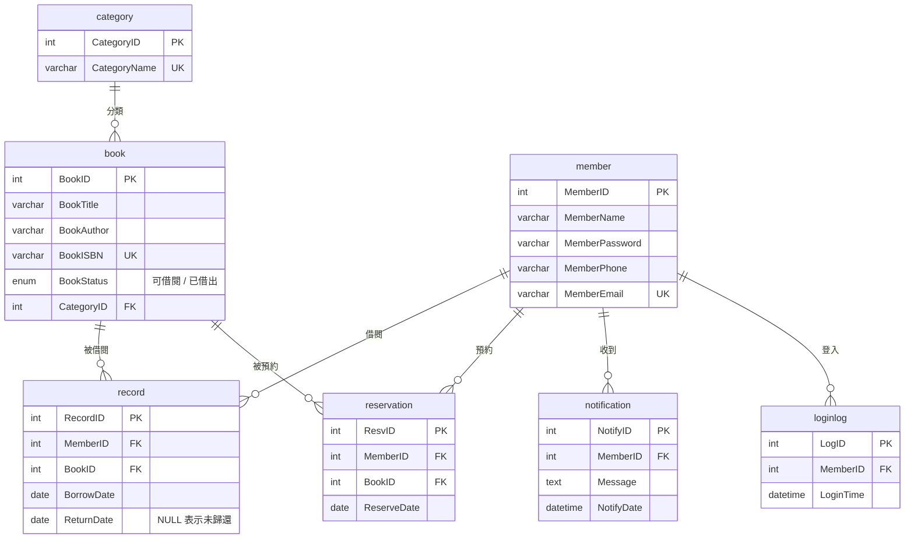
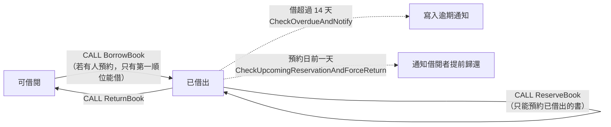

# 📚 圖書館借閱管理系統（MySQL）

資料庫課程期末專案。把圖書館的借書、還書、預約與通知規則，全部實作在資料庫層：用**資料表與約束**保證資料正確，用**預存程序**包裝借還與預約操作，用**觸發器**自動維護書籍狀態，再用**檢視表**提供常用查詢。

---

## 🗂️ E-R 圖



正規化過程（1NF～BCNF）與各資料表說明見 `docs/資料庫期末報告.docx`。

---

## 🔄 借閱流程



---

## 🧩 資料庫程式

### 預存程序

| 程序 | 說明 |
|---|---|
| `BorrowBook(member, book, date)` | 借書：檢查書籍存在且可借閱，新增借閱紀錄，並刪除該會員對這本書的預約 |
| `ReturnBook(member, book, date)` | 還書：找出未歸還的紀錄，寫入歸還日並把書改回「可借閱」 |
| `ReserveBook(member, book, date)` | 預約：只能預約已借出的書，同一會員不可重複預約 |
| `CancelReservation(member, book)` | 取消預約 |
| `CheckOverdueAndNotify()` | 找出借閱超過 14 天未還的紀錄並寫入通知（同一本書不重複通知） |
| `CheckUpcomingReservationAndForceReturn()` | 預約日前一天，通知仍借著這本書的會員提前歸還 |

### 觸發器（都掛在 `record`）

| 觸發器 | 時機 | 說明 |
|---|---|---|
| `trg_before_borrow_reservation_check` | 借書前 | 這本書若有人預約，只允許最早預約的會員借閱，其他人會被擋下 |
| `trg_after_borrow` | 借書後 | 書籍狀態改為「已借出」 |
| `trg_after_return` | 還書後 | 書籍狀態恢復「可借閱」 |

### 檢視表

| 檢視表 | 說明 |
|---|---|
| `borrowedbooks` | 目前借出中的書 |
| `overduebooks` | 借閱超過 14 天未還 |
| `recordsummary` | 借閱紀錄總覽（會員名稱、書名、借還日期） |

---

## 🚀 匯入方式

```bash
mysql -u root -p < librarydb.sql
```

會建立 `librarydb` 資料庫並匯入範例資料（範例會員資料皆為虛構）。

> 本專案在 Windows 的 MySQL 8 上開發。預存程序中部分資料表名稱使用大寫開頭（如 `Book`），
> Linux／macOS 預設區分大小寫，需要先在 MySQL 設定 `lower_case_table_names=1` 再匯入。

---

## 🧪 範例操作

```sql
USE librarydb;

-- 以範例資料中沒有預約紀錄的書 3《世界歷史》示範
CALL BorrowBook(1, 3, CURDATE());          -- 會員 1 借書 3
SELECT * FROM borrowedbooks;

CALL ReserveBook(3, 3, CURDATE());         -- 會員 3 預約已借出的書 3
CALL BorrowBook(4, 3, CURDATE());          -- ❌ 書已借出，借閱失敗

CALL ReturnBook(1, 3, CURDATE());          -- 歸還
CALL BorrowBook(4, 3, CURDATE());          -- ❌ 會員 3 預約在先，只有他能借
CALL BorrowBook(3, 3, CURDATE());          -- ✅ 預約者借閱，預約自動刪除

CALL CheckOverdueAndNotify();              -- 產生逾期通知
SELECT * FROM notification WHERE MemberID = 1;
```

---

## 📁 專案結構

```text
.
├─ librarydb.sql              # 資料表、範例資料、預存程序、觸發器、檢視表
└─ docs/
   ├─ 資料庫期末報告.docx     # 系統說明、E-R Model、正規化與分工
   ├─ 基本功能.docx           # 功能說明
   └─ 上台報告操作.docx       # 展示操作流程
```

---

## 👥 組員

鄭翔元、黃楙登、林晨、蘇奕安
